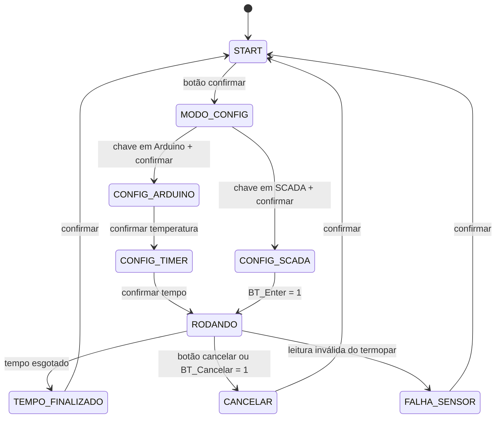

# Código Arduino – Controle de Temperatura do Forno de Torrefação de Amêndoas de Cacau

Código-fonte do protótipo de forno para torrefação de amêndoas de cacau desenvolvido no Trabalho de Conclusão de Curso (TCC).

O Arduino lê a temperatura com um termopar (módulo MAX6675) e liga ou desliga a resistência de aquecimento por meio de um relé, mantendo a temperatura no valor definido durante o tempo escolhido. Os parâmetros podem ser configurados no próprio protótipo (potenciômetro, botões e display LCD) ou por um sistema supervisório (SCADA), via comunicação Modbus.

---

## Funcionalidades

- Controle de temperatura liga/desliga com histerese de 1 °C, de 0 a 240 °C.
- Temporizador de 1 a 240 minutos, com contagem regressiva no display.
- Dois modos de configuração, escolhidos por uma chave alavanca:
  - **Arduino:** temperatura e tempo ajustados no potenciômetro e confirmados no botão.
  - **SCADA:** temperatura e tempo enviados pelo supervisório via Modbus.
- Envio ao SCADA da temperatura atual, do estado da resistência, do tempo restante e da etapa em que o sistema está.
- Cancelamento da execução pelo botão físico ou pelo SCADA.
- Proteção contra falha do sensor: se a leitura do termopar for inválida, a resistência é desligada na hora e a execução é interrompida.
- LEDs indicando a etapa de funcionamento.

## Componentes

- Arduino Uno (ou placa compatível)
- Módulo MAX6675 com termopar tipo K
- Módulo relé (acionamento da resistência de aquecimento)
- Display LCD 16x2 com módulo I2C (endereço 0x27 ou 0x3F)
- Potenciômetro
- 2 botões (confirmar e cancelar)
- 1 chave alavanca (escolha do modo Arduino / SCADA)
- 3 LEDs (verde, vermelho e amarelo) com resistores
- Resistência de aquecimento do forno

## Ligações

| Componente | Pino do Arduino |
|---|---|
| MAX6675 – SO | D5 |
| MAX6675 – CS | D4 |
| MAX6675 – CLK (SCK) | D3 |
| Relé | D7 |
| Potenciômetro (cursor) | A0 |
| Botão confirmar | D9 |
| Botão cancelar | D6 |
| Chave alavanca (modo) | D8 |
| LED verde | D10 |
| LED vermelho | D11 |
| LED amarelo | D12 |
| LCD I2C – SDA / SCL | A4 / A5 (no Uno) |

Os botões e a chave usam o resistor de pull-up interno do Arduino, então cada um é ligado entre o pino e o GND. Com a chave fechada (pino em nível baixo) o modo é **Arduino**; com a chave aberta, o modo é **SCADA**.

## Bibliotecas

| Biblioteca | Uso |
|---|---|
| `max6675.h` (MAX6675 library, Adafruit) | Leitura do termopar |
| `LiquidCrystal_I2C.h` | Display LCD I2C |
| `Modbusino.h` | Comunicação Modbus como escravo |
| `Wire.h`, `math.h` | Já vêm com a IDE do Arduino |

Observação: o código usa `lcd.begin()` sem parâmetros. Se a versão da biblioteca LiquidCrystal_I2C instalada der erro nessa linha, troque por `lcd.init()`.

## Como usar

1. Instale as bibliotecas acima pela IDE do Arduino (**Ferramentas > Gerenciar Bibliotecas**).
2. Abra o arquivo `.ino` na IDE. Se ela pedir para criar uma pasta com o mesmo nome do arquivo, aceite.
3. Selecione a placa e a porta e envie o código.
4. No protótipo:
   - Aperte o botão **confirmar** para começar a configuração.
   - Escolha o modo na chave alavanca e confirme.
   - **Modo Arduino:** ajuste a temperatura no potenciômetro e confirme; depois ajuste o tempo e confirme. O aquecimento começa.
   - **Modo SCADA:** envie a temperatura e o tempo pelo supervisório e acione o comando de iniciar.
5. Ao terminar o tempo, cancelar ou ocorrer falha do sensor, a resistência é desligada. Aperte **confirmar** para voltar ao início.

## Etapas de funcionamento (máquina de estados)

| Etapa | Valor enviado ao SCADA (`Case`) | Display | LEDs |
|---|---|---|---|
| Início | 0 | "Clique para configurar" | Verde |
| Escolha do modo | 1 | "Escolha: ARDUINO" ou "Escolha: SCADA" | Vermelho (Arduino) ou amarelo (SCADA) |
| Aguardando o SCADA | 2 | "Aguardando Config: SCADA" | Amarelo |
| Configuração da temperatura | 3 | Temperatura escolhida | Verde |
| Configuração do tempo | 4 | Tempo escolhido | Verde |
| Execução | 5 | Temperatura, estado da resistência, setpoint e tempo restante | Os três acesos |
| Cancelado | 6 | "CANCELADO" | Vermelho piscando |
| Tempo finalizado | 7 | "TEMPO FINALIZADO" | Amarelo piscando |
| Falha do sensor | 9 | "FALHA NO SENSOR" | Vermelho piscando |

## Controle de temperatura

O controle é do tipo liga/desliga com histerese de 1 °C:

- a resistência **liga** quando a temperatura fica menor ou igual a `setpoint − 1 °C`;
- a resistência **desliga** quando a temperatura passa do `setpoint`.

A temperatura é lida a cada 500 ms.

## Comunicação Modbus (SCADA)

- Arduino como escravo Modbus, **ID 1**
- Porta serial (USB), **9600 bps**
- 13 registradores. O endereço no SCADA é o índice do registrador + 1.

Como o Modbus usa a mesma porta serial do Monitor Serial, não deixe o Monitor Serial aberto enquanto o SCADA estiver conectado.

| Registrador | Endereço | Tag no SCADA | Direção | Descrição |
|---|---|---|---|---|
| `tab_reg[0]` | 1 | Temperatura_Atual | Arduino → SCADA | Temperatura medida × 100 (dividir por 100 para obter °C) |
| `tab_reg[1]` | 2 | Estado_Resistencia | Arduino → SCADA | 0 = desligada; 1 = ligada |
| `tab_reg[2]` | 3 | BT_Cancelar | SCADA → Arduino | 1 = cancelar a execução |
| `tab_reg[3]` | 4 | BT_Enter | SCADA → Arduino | 1 = iniciar com os parâmetros enviados |
| `tab_reg[4]` | 5 | Temperatura_Desejada | SCADA → Arduino | Temperatura desejada, em °C (limitada a 0–240) |
| `tab_reg[5]` | 6 | Case | Arduino → SCADA | Etapa do sistema (ver tabela de etapas) |
| `tab_reg[6]` | 7 | — | — | Não utilizado (antigo Status_Tempo_Finalizado) |
| `tab_reg[7]` | 8 | — | — | Reservado |
| `tab_reg[8]` | 9 | SetPoint | Arduino → SCADA | Temperatura usada no controle, em °C |
| `tab_reg[9]` | 10 | Tempo_Desejado_Min | SCADA ↔ Arduino | Duração configurada, em minutos |
| `tab_reg[10]` | 11 | Tempo_Restante | Arduino → SCADA | Tempo restante, em segundos |
| `tab_reg[11]` | 12 | Bloquear_Controles | Arduino → SCADA | 0 = controles do SCADA liberados; 1 = bloqueados |
| `tab_reg[12]` | 13 | — | — | Reservado |

## Segurança

Este é um protótipo acadêmico que aciona uma resistência ligada à rede elétrica. Use relé adequado para a corrente da resistência e faça a montagem com o circuito desligado.
